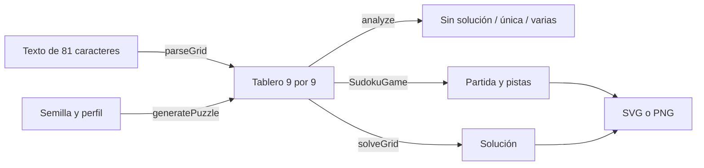

# Sudoku para aplicaciones, juegos e imágenes

`sudoku-easy-solver` genera sudokus 9×9 con solución única, resuelve tableros,
comprueba soluciones y ofrece pistas, candidatos, partidas con historial y
exportación visual. El núcleo no tiene dependencias de ejecución.

```sh
npm install sudoku-easy-solver
```

Compatible con Node.js 22 o superior; el núcleo ESM también funciona en navegadores
modernos. PNG y el helper de workers son entradas opcionales exclusivas de Node.js.

```ts
import { generateDetailed, SudokuGame, renderSudokuSvg, SudokuDifficulty } from 'sudoku-easy-solver';

const puzzle = generateDetailed({
  seed: 'sudoku-del-dia', difficulty: SudokuDifficulty.MEDIUM, symmetry: 'rotational',
});
const game = new SudokuGame(puzzle.grid);
const hint = game.getHint({ allowGuess: false });
if (hint) game.placeNumber(hint.position, hint.value);
game.undo();
const svg = renderSudokuSvg(game.getGrid(), {
  title: 'Un momento para pensar', theme: 'paper',
});
```

## Elige la API adecuada

- **Funciones puras:** `solveGrid`, `analyze`, `countSolutions`, `getCandidates`,
  `getConflicts`, `getHint`, `rateDifficulty`, `parseGrid`, `stringifyGrid`.
- **Tablero mutable:** `Sudoku`; `solve()` rellena esa instancia y `getGrid()` devuelve una copia.
- **Partida:** `SudokuGame`; protege las pistas originales y conserva hasta 100 pasos de deshacer.
- **Generación:** `generatePuzzle` devuelve el tablero; `generateDetailed` también devuelve
  solución, cantidad de pistas y objetivo de pistas.
- **Imágenes:** `renderSudokuSvg` en el núcleo; `renderSudokuPng` desde
  `sudoku-easy-solver/image`, con `@resvg/resvg-js` instalado.
- **Trabajo en segundo plano:** `solveGridAsync` desde `sudoku-easy-solver/async`.

Las filas y columnas empiezan en 0. Los valores válidos son enteros 0–9; 0 representa
una casilla vacía. No se modifica el array que entrega el usuario.



## Qué garantiza y qué no

La generación conserva una única solución. Los perfiles `easy`, `medium`, `hard` y
`expert` buscan 46, 36, 29 y 23 pistas respectivamente: **no son una medida de la
dificultad humana**. La unicidad y la simetría tienen prioridad, por lo que el
resultado puede tener más pistas. Consulta `clues` y `targetClues`.

`rateDifficulty` utiliza una heurística de singles y búsqueda; no implementa un
sistema completo de técnicas humanas. Las pistas explican naked singles y hidden
singles. Si no hay uno, pueden revelar una casilla de una solución: se identifica
como `solution` y puede no ser una jugada forzada si existen varias soluciones.
Usa `allowGuess: false` para obtener únicamente las dos técnicas lógicas.
Las explicaciones de las pistas se devuelven en inglés.

`validateGrid` comprueba reglas locales; `analyze` comprueba resolubilidad y unicidad.
Un movimiento localmente válido puede dejar un tablero sin solución.
`countSolutions` se detiene en su límite: 2 significa al menos dos soluciones.

La búsqueda tiene un presupuesto de nodos y admite `AbortSignal`. Si agota el
presupuesto, lanza `SearchLimitError`; `analyze` devuelve `limit-exceeded`, que no
significa que el sudoku sea imposible. La búsqueda síncrona bloquea mientras
trabaja; usa el worker en Node o tu propio Web Worker en navegador.

No se admiten variantes, tableros de otros tamaños, JPEG/PDF ni todas las técnicas
avanzadas. Las semillas son reproducibles dentro de la misma versión, no se promete
estabilidad entre versiones. El generador no es criptográfico ni uniforme entre
todos los sudokus posibles.

Consulta la [referencia completa](API.md), la [guía de imágenes](IMAGES.md) y los
[ejemplos ejecutables](../examples/README.md).
