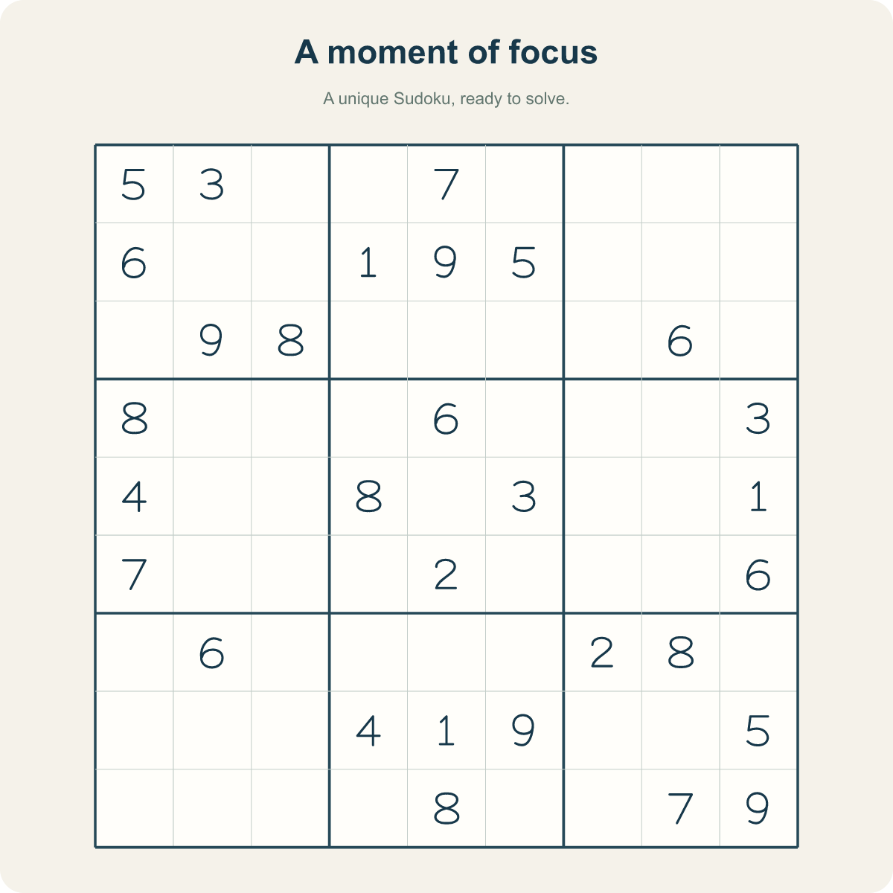
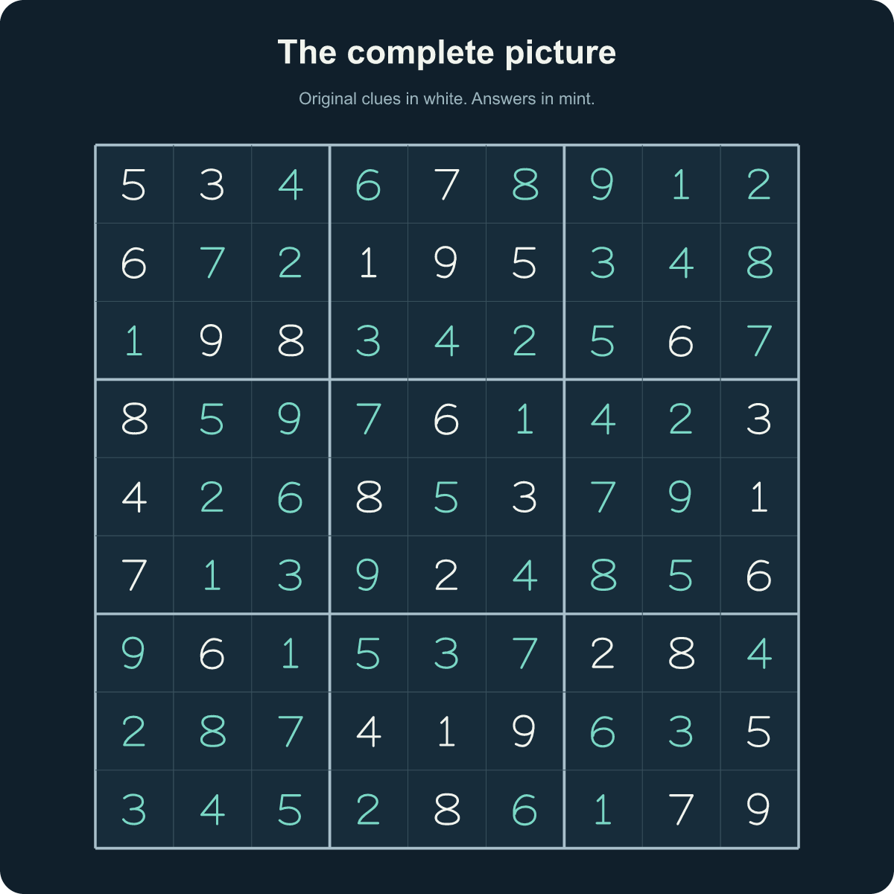
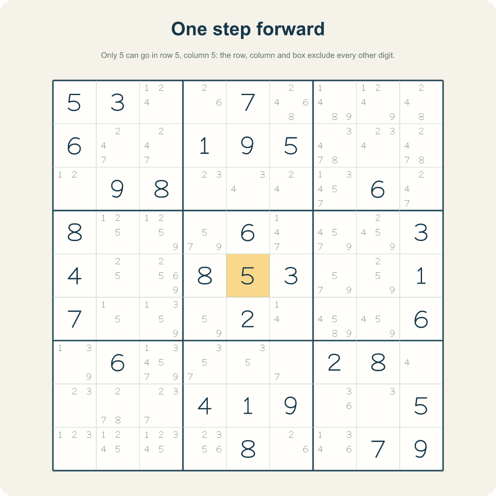
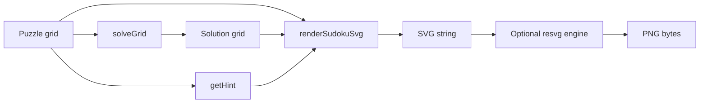

# Image export

Images are rendered from the actual grid. The library does not use generative AI.
SVG is available in the dependency-free core. PNG uses an optional Node.js rasterizer.

## From puzzle to picture

These are actual **1200 × 1200 PNG files** produced by
[`examples/images.mjs`](../examples/images.mjs). Click a preview for the original.

| Puzzle · `paper` | Solution · `midnight` |
| :---: | :---: |
| [](assets/puzzle.png) | [](assets/solution.png) |
| A clean board to print or share. | Pass `givens` to distinguish clues from answers. |

### Show the next move

<p align="center">
  <a href="assets/hint.png">
    
  </a>
</p>

The center cell has only one possible value: **5**. `getHint()` supplies the move
and its explanation; `showCandidates` adds the pencil marks, and `hint` highlights
the suggested value without changing the input grid.

## Render your own

Install the package and its optional PNG engine:

```sh
npm install sudoku-easy-solver @resvg/resvg-js
```

```ts
import { parseGrid, renderSudokuSvg, solveGrid, getHint } from 'sudoku-easy-solver';
import { renderSudokuPng } from 'sudoku-easy-solver/image';
import { writeFile } from 'node:fs/promises';

const grid = parseGrid(
  '530070000600195000098000060800060003400803001700020006060000280000419005000080079',
);

await writeFile('puzzle.svg', renderSudokuSvg(grid, { title: 'A moment of focus' }));
await writeFile('puzzle.png', await renderSudokuPng(grid, { size: 1200 }));

const solution = solveGrid(grid);
if (solution) {
  await writeFile('answer.png', await renderSudokuPng(solution, {
    title: 'Answer sheet', givens: grid, theme: 'midnight',
  }));
}

const hint = getHint(grid, { allowGuess: false });
if (hint) {
  await writeFile('hint.png', await renderSudokuPng(grid, {
    title: 'One step forward', hint, showCandidates: true,
  }));
}
```

Install `@resvg/resvg-js` before calling the PNG function. It is an optional peer,
not a dependency of the solver. No browser, network service or API key is needed.

To regenerate the documentation previews from a clone of this repository:

```sh
npm ci
npm run build
npm run docs:assets
```

The files are written to `docs/assets/`, in both SVG and PNG format.

## Options

| Option | Meaning |
| --- | --- |
| `size` | Square SVG/PNG size, integer 256–2048; default 900. |
| `theme` | `'paper'` (warm ivory + teal), `'midnight'` (dark + mint), `'minimal'` (monochrome). |
| `title` | Optional text, at most 60 characters. |
| `subtitle` | Optional text, at most 100 characters. |
| `givens` | Original grid. Existing clues must agree with the displayed board. Added solution digits use the accent color. |
| `showCandidates` | Render locally legal pencil marks in empty cells. Default false. |
| `hint` | `{ position, value }`. Highlights and previews the value in an empty cell without modifying the data. The value must be locally legal. |
| `highlights` | Up to 81 valid positions, independently highlighted. |

Numerals use built-in vector paths, so digit rendering does not depend on installed
fonts. Optional headings use system fonts; typography can differ between machines.
The SVG contains an accessible title and a textual description of the board.

Titles are escaped as text. No external image URLs, HTML, scripts or custom SVG are
accepted. The renderer does not calculate a solution automatically or validate the
uniqueness of a puzzle. Provide `solveGrid()` output for answer sheets and `getHint()`
output for hints. `showCandidates` shows local possibilities, not guaranteed answers.

The PNG function returns a `Uint8Array`. Write it to a file, send it in an HTTP
response with `Content-Type: image/png`, or store it in your application's media
storage. Rendering is synchronous native work inside the asynchronous module-loading
wrapper; move bulk image generation into a worker or job queue if responsiveness matters.

## Browser SVG and rasterization

The SVG string can be saved as a Blob or displayed as an image URL. For a browser-only
PNG workflow, draw that SVG into a canvas and use `canvas.toBlob()`. The packaged
`/image` entry is Node-only; do not import it into a browser bundle.



All example boards should be produced by the renderer from valid fixtures, never
hand-drawn or generated with AI.
